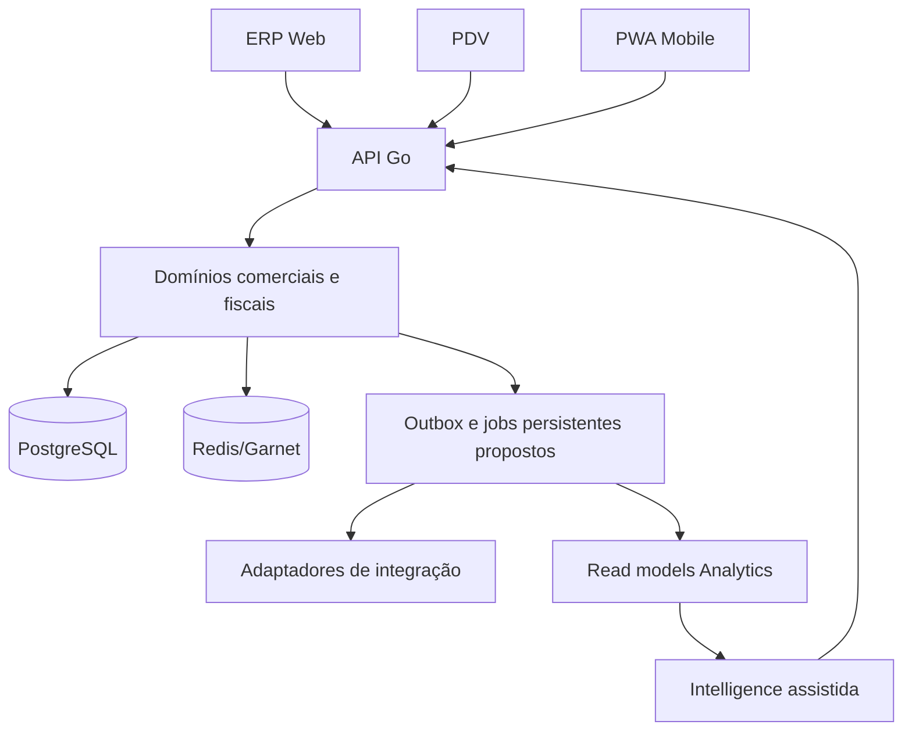

# Arquitetura técnica proposta

## Decisão
Evoluir monólito modular Go + React/TypeScript + PostgreSQL + Redis/Garnet. Preservar API, módulos, migrações e isolamento existentes; refatoração incremental somente com testes de comportamento. Não adotar microserviços, data warehouse externo ou Kubernetes sem necessidade medida.

## Fronteiras
- Vendas é fonte de verdade de vendas e itens; estoque de movimentos/saldo; financeiro de obrigações, lançamentos e liquidações; fiscal de obrigação, autorização e artefato; compras de pedidos/recebimentos; clientes de cadastro/consentimento.
- Não duplicar lançamentos por módulo nem editar histórico de caixa/fiscal. Ajustes compensatórios com autor, motivo e vínculo.
- API REST versionada; contratos explícitos e erros estáveis; validar entrada no servidor, UI valida para feedback. Tipos monetários exatos, datas com fuso definido e limites de período.
- Transação única para mutações críticas acopladas no mesmo banco. Eventos externos somente depois de commit via outbox transacional quando necessário; consumidor idempotente, retries limitados, backoff, estado de erro e reprocessamento auditado.
- Evento proposto: event_id, tenant_id, type/version, occurred_at, aggregate_id, correlation_id, payload mínimo. Nunca incluir segredo ou PII desnecessária. Projetar ordenação por agregado, deduplicação, schema evolutivo e reconciliação. Avaliar bus existente antes de substituir.
- Read models analíticos podem atrasar; exibir última atualização. Recomputar a partir do histórico e reconciliar com fontes oficiais; não permitir que falha analítica bloqueie PDV.
- Adaptadores Pix/TEF, XML, canais e IA isolados por interface real; timeouts, circuit breaker quando justificado, verificação de assinatura de webhooks, idempotência, reconciliação e configuração segregada.

## Segurança e operação
Escopo tenant em API, query, cache, filas, arquivos e exportações; autorização por ação no backend, não só UI. Menor privilégio, segredos fora de Git e logs, TLS na LAN, certificados confiáveis, autenticação forte para ações administrativas, backups criptografados fora do host, retenção e recuperação testada. Não expor servidor local diretamente à internet. Acesso remoto futuro via canal privado autenticado e revogável.

## Código e dados
Manter backend/internal/modules e web/src conforme arquitetura atual; propor módulos ou submódulos somente após inventário. Migrações novas append-only, rollback seguro ou procedimento forward-fix documentado, sem destruir dados. Índices guiados por EXPLAIN e carga realista; medir latência e memória. Testes de fronteira impedem bypass do domínio. Job observável com last success, lag, retry, fila e correlation ID.

## Gate
ADR para cada mudança transversal, diagrama e responsabilidade, esquema/contrato, invariantes, cenários de falha, testes e plano de migração/recuperação. Nenhuma troca de tecnologia é requisito de 2.0.
